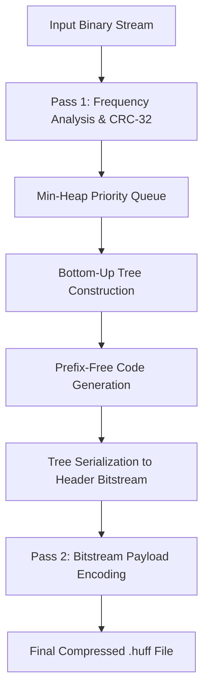

# Huffman Coding: Algorithmic Architecture & Theory

This document details the algorithms, data structures, and mathematical foundations utilized in the Huffman File Compressor tool.

---

## 1. Algorithmic Overview

Huffman coding is an optimal prefix coding algorithm developed by David A. Huffman in 1952. It assigns variable-length bit strings to input symbols such that more frequent symbols receive shorter bit codes, while less frequent symbols receive longer bit codes.

The algorithm achieves minimum redundancy among all symbol-by-symbol prefix codes.

---

## 2. Step 1: Frequency Analysis & Checksum

- The input stream is read in binary chunks of 64 KB (`HUFF_BUFFER_SIZE`).
- An array `uint64_t freqs[256]` tracks the exact occurrence of each byte ($0x00$ through $0xFF$).
- Byte values are strictly converted to `unsigned char` / `uint8_t` prior to array indexing, eliminating signed-char negative indexing defects.
- Concurrently, an IEEE 802.3 CRC-32 is accumulated across all chunks to produce an end-to-end integrity signature.

---

## 3. Step 2: Min-Heap Priority Queue & Deterministic Tie-Breaking

To build the Huffman tree in $O(N \log N)$ time, a binary min-heap priority queue is implemented.

### Deterministic Tie-Breaking
Standard Huffman implementations can vary depending on tie-breaking rules, producing different trees on different compilers or platforms. To ensure strict cross-platform reproducibility, the comparator `compare_nodes(A, B)` implements total ordering:

1. **Frequency**: Primary key. Lower frequency node has higher priority.
2. **Minimum Symbol (`min_symbol`)**: Secondary key. For leaves, `min_symbol = symbol`. For internal nodes, `min_symbol = min(left->min_symbol, right->min_symbol)`. The smaller minimum symbol has priority.
3. **Node Type**: Tertiary key. Leaves take priority over internal nodes of identical frequency and minimum symbol.
4. **Sequence ID (`seq_id`)**: Quaternary key. Unique monotonically increasing identifier assigned to each internal node upon creation.

### Priority Queue Operations
- `minheap_push`: $O(\log K)$ sift-up insertion.
- `minheap_pop`: $O(\log K)$ sift-down extraction of the root (minimum element).

---

## 4. Step 3: Huffman Tree Construction

The tree is constructed bottom-up from the min-heap:

1. For each symbol $i$ with `freqs[i] > 0`, allocate a leaf node `HuffmanNode` and insert it into the min-heap.
2. While the heap size is greater than 1:
   - Pop the two lowest-frequency nodes: $L$ and $R$.
   - Allocate an internal parent node with `left = L`, `right = R`, and `freq = L->freq + R->freq`.
   - Push the internal node back into the min-heap.
3. When exactly 1 node remains in the heap, it is popped as the root of the tree.

---

## 5. Step 4: Code Generation & Prefix-Free Property

The tree is traversed from the root to each leaf using recursion:
- Traversal down the left child appends a bit `0`.
- Traversal down the right child appends a bit `1`.
- Upon reaching a leaf, the accumulated bit sequence and its length are saved to the `HuffmanCodeTable`.

### Bounded Depth & Representation
Codes can be up to 256 bits long in extreme worst-case frequency distributions. Instead of restricting codes to 64-bit integer masks, the implementation stores codes as `uint8_t bits[32]` with a 16-bit length field. This guarantees no bit overflow regardless of tree depth.

### Prefix-Free Property
No code is a prefix of any other code. As demonstrated in unit tests, this property guarantees that the bitstream can be uniquely and instantaneously decoded without lookahead.

---

## 6. Step 5: Bit-Level Streaming & Buffering

Disk operations occur in byte units, but Huffman codes are bit sequences:
- `BitWriter`: Accumulates bits MSB-first into a byte accumulator `current_byte`. When 8 bits are filled, the byte is placed into a 64 KB memory buffer. When the buffer is full, a single `fwrite` flushes it to disk.
- `bitwriter_flush`: When encoding completes, any remaining partial byte is left-shifted (padded with trailing `0`s) and written out.
- `BitReader`: Pulls 64 KB blocks from disk and feeds individual bits or words to the deserializer and decoder.

---

## 7. Step 6: Decompression & Exact Termination

Decompression traverses the tree from root to leaf:
1. Start at `curr = root`.
2. Read 1 bit from `BitReader`.
3. If bit is `0`, move to `curr = curr->left`; if bit is `1`, move to `curr = curr->right`.
4. If `curr->is_leaf`, output `curr->symbol`, update running CRC-32, and reset `curr = root`.
5. Repeat steps 1–4 until `bytes_decoded == header.original_size`.

### Immunity to Padding Bits
Because the loop terminates strictly when `bytes_decoded == header.original_size`, any trailing 0 padding bits inserted by the encoder in the final byte are safely ignored without generating phantom output bytes.

---

## 8. Special Cases

### 1. Empty File (0 Bytes)
- Frequency analysis detects `original_size == 0`.
- Sets `HUFF_FLAG_EMPTY_FILE` in header.
- No tree or payload bitstream is emitted.
- Decompressor creates a 0-byte file immediately.

### 2. Single Unique Symbol
- Occurs when a file consists of $N$ copies of a single byte (e.g. 5 MB of `'A'`).
- In classic Huffman coding, a single symbol cannot form a standard two-child root without a dummy node.
- Solved cleanly via `HUFF_FLAG_SINGLE_SYMBOL`: the single byte is saved directly in header metadata, achieving maximal compression ratio without storing millions of redundant bits.

---

## 9. Complexity Analysis

| Phase | Time Complexity | Space Complexity |
| :--- | :--- | :--- |
| **Pass 1: Frequency Analysis** | $O(M)$ | $O(1)$ (64 KB buffer) |
| **Min-Heap Build** | $O(K \log K)$ ($K \le 256$) | $O(K)$ |
| **Tree Construction** | $O(K \log K)$ | $O(K)$ ($2K - 1$ nodes) |
| **Code Generation** | $O(K \cdot D)$ ($D \le 256$) | $O(K)$ |
| **Tree Serialization** | $O(K)$ | $O(1)$ |
| **Pass 2: Bit Encoding** | $O(M)$ | $O(1)$ (64 KB buffer) |
| **Decompression** | $O(M)$ | $O(K)$ tree + $O(1)$ buffer |

Where:
- $M$: File size in bytes.
- $K$: Distinct symbols count ($0 \le K \le 256$).
- $D$: Maximum tree depth.
